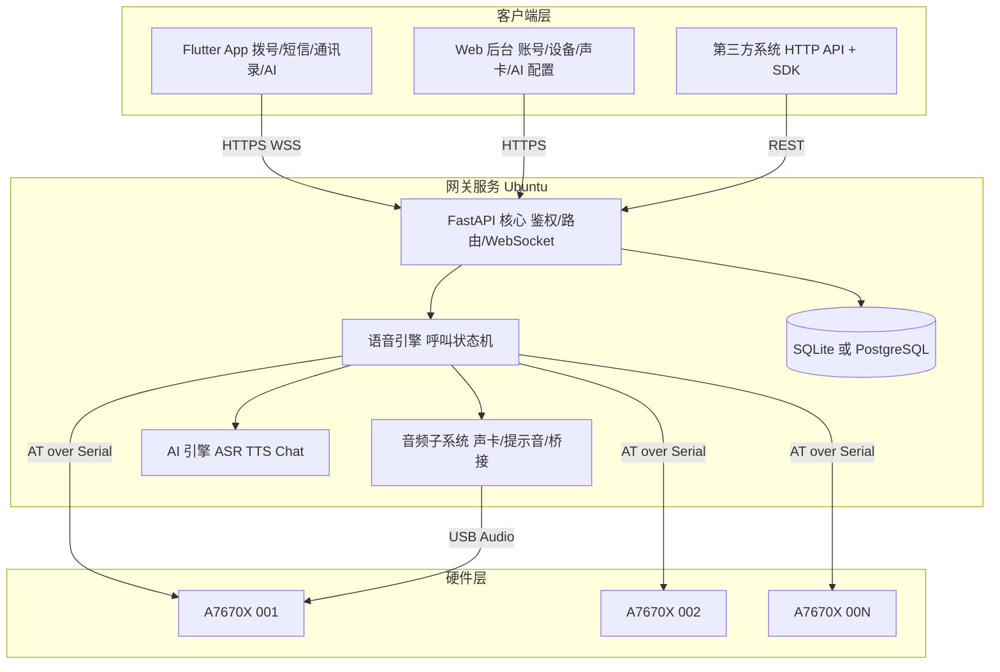
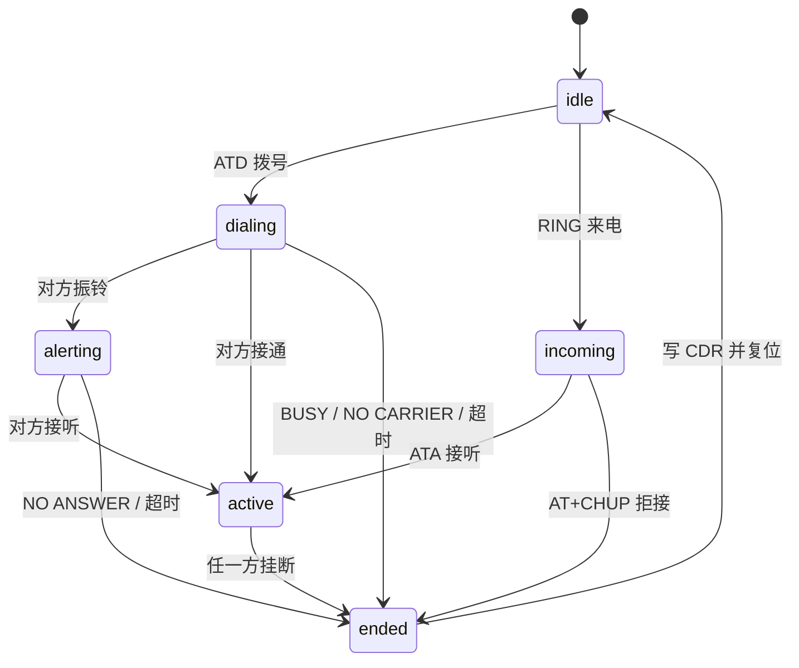

# 4G 语音短信网关商业化方案

> 项目代号：**VoiceSMS Gateway**（基于 sms-gateway 二次开发）
> 硬件平台：SIMCom A7670X / A7670G 4G USB Dongle
> 文档版本：v1.0　编制日期：2026-10-13

---

## 1. 产品定位

把一块几十元的 A7670X 4G USB 小板子，做成一台可远程操控的语音与短信网关。一台服务器可以插 N 个模块，对外表现为 N 个独立的手机号，支持：

- 收发短信（中英文、长短信、PDU 模式）——原项目已具备
- 拨打与接听电话、通话中 TTS 播报、DTMF 按键——本次新增
- 手机 App 远程拨号与收发短信——本次新增
- AI 语音助手接管通话（ASR + LLM + TTS）——本次新增
- 网页后台统一管理账号、设备、声卡、AI 供应商——本次新增

### 1.1 目标客户

| 客群 | 场景 | 付费意愿 |
| --- | --- | --- |
| 中小企业 | 订单通知、验证码短信、售后回访外呼 | 中 |
| 物业与园区 | 门禁通知、缴费提醒、紧急广播 | 中 |
| 连锁门店 | 会员营销短信、到店提醒电话 | 中高 |
| 集成商与 ISV | 把网关嵌进自己的 SaaS，按 SIM 数收费 | 高 |
| 开发者与个人 | 自建短信验证、远程播报、AI 电话 | 低但量大 |

### 1.2 与现有方案的差异

云通信按条计费，短信需要企业资质报备签名模板，语音通知单价更高；传统 GSM 猫池是灰产重灾区。本产品定位是合规的自建私有网关：数据落在客户自己的服务器上，按硬件台数和授权数收费，边际成本接近于零，客户对单条成本没有感知。

---

## 2. 系统架构

### 2.1 关键设计决策

**控制面与媒体面分离。** AT 串口只负责呼叫控制（拨号、接听、挂断、TTS、DTMF），音频媒体走模块枚举出来的 USB 声卡。这样服务器上的声卡选择、混音、录音、AI 语音都能独立演进，不受串口带宽限制。

**每个模块一个 Worker，独占一个 AT 口。** 沿用原项目的物理 USB 分组策略，避免多设备抢同一串口。呼叫状态机按设备隔离，天然支持多路并发通话。

**Mock 优先。** 所有硬件交互都抽象出接口并提供 Mock 实现，开发期没有硬件也能完整联调，硬件到货后把 SMSGW_MOCK_MODEM 切成 false 即可。

---

## 3. 功能清单与优先级

| 编号 | 功能 | 优先级 | 状态 |
| --- | --- | --- | --- |
| F01 | 多模块短信收发（中英文、长短信、PDU） | P0 | 原项目已具备 |
| F02 | Web 实时短信与 WebSocket 推送 | P0 | 原项目已具备 |
| F03 | HTTP API 与 API Key 鉴权配额 | P0 | 原项目已具备 |
| F04 | 语音通话：拨打、接听、挂断、DTMF | P0 | 本次新增 |
| F05 | 通话中 TTS 播报（模块内置合成） | P0 | 本次新增 |
| F06 | 通话记录 CDR | P0 | 本次新增 |
| F07 | 声卡枚举与输入输出设备选择 | P0 | 本次新增 |
| F08 | 基础提示音（正在接通请稍候、忙线、空号） | P0 | 本次新增 |
| F09 | 网页后台多账号管理（增删改查、角色、改密） | P0 | 本次新增 |
| F10 | Flutter App：登录、拨号、短信、通讯录 | P0 | 本次新增 |
| F11 | AI 语音转文字 ASR | P1 | 本次新增 |
| F12 | AI 文字转语音（云端 TTS） | P1 | 本次新增 |
| F13 | AI Chat 对话（通话内智能应答、短信自动回复） | P1 | 本次新增 |
| F14 | 通话录音与转写归档 | P1 | 录音软件采集、归档、下载接口已完成；声卡真机与转写待联调 |
| F15 | 通讯录与联系人分组 | P1 | 本次新增 |
| F16 | 定时任务与群发 | P2 | 本次新增 |
| F17 | 多租户与计费计量 | P2 | 本次新增 |
| F18 | PostgreSQL 与 Redis 横向扩展 | P2 | 本次新增 |

---

## 4. 硬件接口与 AT 指令规范

本节指令来自 A7670X 官方资料与实测教程，是语音模块实现的依据。

### 4.1 模块枚举与端口分配

A7670X 通过 USB 枚举出多个接口，Linux 下表现为多个 /dev/ttyUSB*，Windows 下表现为多个 COM 口：

| 接口 | 用途 | 本项目是否使用 |
| --- | --- | --- |
| DM | 诊断 | 否 |
| NMEA | GPS（若带 GPS） | 否 |
| AT | AT 指令 + URC | 是（控制面） |
| Modem | AT 指令（PPP） | 备用 |
| Audio | USB 声卡（通话音频） | 是（媒体面） |

原项目的 discover_at_ports 已经做了物理 USB 分组与端口优先级排序，语音功能直接复用同一套设备表，不新增端口发现逻辑。

### 4.2 短信指令（已实现）

| 指令 | 说明 |
| --- | --- |
| ATE0 | 关闭回显 |
| AT+CMEE=2 | 详细错误上报 |
| AT+CMGF=0 | PDU 模式 |
| AT+CPMS="SM","SM","SM" | 短信存储选 SIM 卡 |
| AT+CNMI=2,1,0,0,0 | 新短信以 +CMTI 上报 |
| AT+CMGL=4 | 启动时扫描存量短信 |
| AT+CMGR=idx / AT+CMGD=idx | 读取与删除 |
| AT+CMGS=len | 发送 PDU，随后写入 PDU 与 0x1A |

中文短信的 PDU 中 TP_DCS 为 08（UCS2 16bit），英文为 00（GSM 7bit）。原项目统一走 UCS2 编码，兼容性最好，代价是单条容量从 160 降到 70 字。

### 4.3 语音指令（本次新增）

| 指令 | 说明 | 本项目用途 |
| --- | --- | --- |
| AT+CPIN? | SIM 卡状态 | 上线自检 |
| AT+CSQ | 信号强度 0-31 | 设备列表展示 |
| AT+CREG? / AT+CEREG? | 网络注册状态 | 上线自检 |
| AT+CDTAM=1 | 开启语音与数据并发 | 通话前必开，否则通话会挤掉数据 |
| AT+CLIP=1 | 开启来电显示 | 收到 RING 时能拿到主叫号码 |
| ATD号码; | 发起语音呼叫，分号不可省 | 拨号 |
| ATA | 接听来电 | App 与 Web 的接听按钮 |
| AT+CHUP | 挂断当前或全部呼叫 | 挂断 |
| ATH | 挂断（备用） | 兼容旧固件 |
| AT+CVHU=1 | 允许 AT+CHUP 挂断 | 初始化时设置 |
| AT+CLCC | 列出当前通话 | 状态机校正 |
| AT+VTS="n" | 发送 DTMF | 通话中按键 |
| AT+CTTS=2,"文本" | GB2312 编码 TTS 播报 | 中文提示音 |
| AT+CTTS=1,"UCS2十六进制" | UCS2 编码 TTS 播报 | 兼容性更好的中文播报 |
| AT+CTTS=0 | 停止播报 | 打断 |
| AT+CSDVC=n | 切换音频通道（听筒或 USB） | 把通话音频导到服务器声卡 |
| AT+CLVL=n / AT+CLVL? | 通话音量 | 音量调节 |
| AT+CMUT=n | 麦克风静音 | 静音 |

### 4.4 语音相关 URC

| URC | 含义 | 状态机动作 |
| --- | --- | --- |
| RING | 来电振铃，周期性重复 | 进入 incoming，取 +CLIP 号码 |
| +CLIP: "号码",129,,0,,0 | 主叫号码 | 填充来电号码 |
| OK（ATD 后） | 拨号请求已受理 | 进入 dialing |
| +CIEV / 载波信号 | 对端接通 | 进入 active |
| NO CARRIER | 通话结束或未接通 | 进入 ended，记录原因 |
| BUSY | 对方忙 | 进入 ended，原因 busy |
| NO ANSWER | 无应答 | 进入 ended，原因 no_answer |
| NO DIALTONE | 无拨号音 | 进入 ended，原因 no_dialtone |
| +CTTS: n | TTS 播报进度或结束 | 播报回调 |
| +CMS ERROR / +CME ERROR | 指令错误 | 抛出 ModemError |

### 4.5 呼叫状态机

每次状态迁移都会：写入 call_sessions 表、通过 WebSocket 广播 call.state 事件、按需播放提示音。

---

## 5. 实施路线图

每个阶段都必须通过联调测试才能进入下一阶段。测试分两层：Mock 层（无硬件，跑在 CI 与开发机上）和硬件层（插入真实 A7670X 后的实测清单）。

| 阶段 | 内容 | 交付物 | 联调验收标准 |
| --- | --- | --- | --- |
| P0 | 环境与基线 | venv、依赖、mock 启动 | 原项目 health 返回 ok，setup 向导可创建管理员 |
| P1 | 语音 AT 层与状态机 | app/voice/* | Mock 下完成拨号、接听、挂断、DTMF、TTS 全流程，状态迁移与 CDR 正确 |
| P2 | 通话 API 与实时事件 | routes_voice.py | REST 发起呼叫返回 call_id，WebSocket 收到完整状态序列，App 与 Web 同源 |
| P3 | 音频子系统 | app/audio/* | 枚举出本机声卡，切换默认输入输出并持久化，提示音正确播放 |
| P4 | 提示音库 | assets/prompts/* | 六类提示音可生成、可试听、可在通话中按状态自动播放 |
| P5 | 多账号后台 | routes_admin.py | 管理员可增删改查账号、重置密码、切换角色与启用状态，权限隔离生效 |
| P6 | AI 引擎 | app/ai/* | ASR、TTS、Chat 三个通道各自可配置供应商并通过 Mock 供应商联调 |
| P7 | Web 控制台扩展 | webadmin | 拨号盘、通话面板、声卡设置、AI 设置、账号管理五个页面可用 |
| P8 | Flutter App | mobile/ | 登录、拨号盘、通话中界面、短信会话列表与详情、通讯录、设置全链路可跑 |
| P9 | 部署与打包 | install.sh、Docker | 一键部署到 Ubuntu 22.04，systemd 常驻，TLS 正常 |
| P10 | 硬件实测 | docs/REAL_DEVICE_INTEGRATION.md | 真实 A7670X 上拨打接听播报全部通过 |

### 5.1 联调测试策略

没有硬件的情况下，语音功能的正确性靠三个手段保证：

第一，Mock 模块实现与真实模块相同的接口，并按状态机时序主动推送 URC（RING、NO CARRIER 等），可以模拟来电、忙线、无应答、超时等所有分支。

第二，AT 层写成纯字符串协议解析器，输入是模块返回的行，输出是事件，可以脱离串口做单元测试。真实硬件抓到的串口日志可以直接回灌成测试用例。

第三，提供 AT 直通调试接口，硬件到货后可以在 Web 上手敲指令看原始返回，快速定位固件差异。原项目的串口监控教程思路（ATE0 关回显、AT+CLIP=1 开来电显示）已经内建到初始化序列里。

### 5.2 真机联调结论（已完成）

真实模块与真实 SIM 上的联调记录见 [REAL_DEVICE_INTEGRATION.md](REAL_DEVICE_INTEGRATION.md)：App 发起的呼叫接通 27 秒后由用户挂断，中文短信真实送达，设备列表、提示音与声卡选择在真机上均可用。

联调同时确认两条固件边界：该固件不带 TTS 语音库（AT+CTTS 全部 ERROR），模块也没有暴露 USB 声卡。因此通话内播放云端 TTS 需要底板或外接声卡提供音频通路；在硬件通路就绪前，产品按降级策略交付，即通话内只播本地提示音，AI 语音回复以短信或 App、网页播放的形式送达。

---

## 6. 商业模式

### 6.1 授权方式

采用**硬件授权 + 订阅**双轨制，避免纯订阅在小客户处的抵触心理。

| 版本 | 授权形式 | SIM 卡数上限 | 语音通话 | AI 能力 | 定价（人民币） |
| --- | --- | --- | --- | --- | --- |
| 社区版 | 开源免费 | 1 | 无 | 无 | 0 |
| 标准版 | 买断授权 | 4 | 有 | 无 | 1,980 / 服务器 |
| 专业版 | 买断授权 | 16 | 有 | 有 | 5,980 / 服务器 |
| 企业版 | 买断授权 | 不限 | 有 | 有 | 19,800 / 服务器 |
| 云托管版 | 年订阅 | 按 SIM 数 | 有 | 有 | 288 / SIM / 年 |

买断授权包含一年升级与工单支持，续保按授权费的 20% 每年计。

### 6.2 收入结构预估（首年）

| 来源 | 客单价 | 目标客户数 | 收入 |
| --- | --- | --- | --- |
| 专业版授权 | 5,980 | 120 | 71.8 万 |
| 企业版授权 | 19,800 | 20 | 39.6 万 |
| 云托管订阅 | 288/SIM/年 | 300 SIM | 8.6 万 |
| 定制开发 | 3 万起 | 8 | 24 万 |
| 硬件差价 | 60/台 | 500 | 3 万 |
| 合计 | | | 约 147 万 |

### 6.3 成本结构

| 项目 | 首年支出 |
| --- | --- |
| 研发人力（2 人 6 个月） | 48 万 |
| 硬件采购（A7670X + SIM + 天线，20 套） | 1.6 万 |
| 云服务器与测试环境 | 2.4 万 |
| AI 接口调用（开发期） | 1.2 万 |
| 资质与法务（增值电信业务备案咨询） | 3 万 |
| 合计 | 约 56 万 |

毛利率约 62%，主要成本集中在前期研发，后续边际成本极低。

### 6.4 渠道

1. 淘宝与闲鱼卖「4G 短信语音网关一体机」，硬件预装系统，客单价 399 到 1299，用硬件带动授权。
2. 开源社区版放 GitHub，用 Star 引流，社区版限制单 SIM 且无语音，付费升级路径清晰。
3. 对接钉钉、企业微信、飞书的机器人市场，作为消息触达通道上架。
4. 面向集成商提供 OEM 白标版本，按项目分成。

---

## 7. 合规与风险控制

这部分决定产品能不能长期卖，必须在设计阶段就考虑。

### 7.1 电信资质

自建自用（客户拿自己的 SIM 卡、给自己的客户发短信打电话）属于企业内部通信工具，不需要增值电信业务许可证。
一旦对外提供短信或语音发送服务并收费，就落入第二类增值电信业务（SP 证）范围。
产品定位必须坚持**私有化部署 + 客户自备 SIM**，把资质责任留在客户侧，并在合同与用户协议中写明。

### 7.2 实名与反滥用

| 风险 | 控制措施 |
| --- | --- |
| 被用于电信诈骗或群发垃圾短信 | 内置发送频率限制（原项目已有 WindowLimiter）、单号每日上限、黑名单、内容关键词过滤 |
| 猫池规避实名 | 每台设备绑定 ICCID 与 IMEI 入库，后台可查可审计，异常高频自动熔断 |
| 通话录音侵犯隐私 | 录音默认关闭，开启时必须在通话开头播报「本次通话可能被录音」，并提供录音保留期与一键删除 |
| 数据出境 | AI 供应商可配置为国内节点，支持完全本地化的 ASR 与 TTS 模型，客户可关闭云端 AI |

### 7.3 审计能力

原项目的 audit_log 已经记录了用户与 API Key 的所有关键操作。本次扩展把通话、录音、AI 调用、账号变更全部纳入审计，
审计日志默认保留 180 天，支持导出 CSV 供客户自查或配合监管调查。

---

## 8. 部署与运维

### 8.1 部署形态

| 形态 | 适用场景 | 说明 |
| --- | --- | --- |
| 单机 systemd | 中小客户 | 沿用原项目 install.sh，一键装依赖、配 systemd、签 TLS、设串口权限 |
| Docker Compose | 开发者与集成商 | 需要把 /dev/ttyUSB* 与声卡设备透传进容器 |
| 一体机 | 非技术客户 | 迷你主机预装 Ubuntu 与全套服务，插电插卡即用 |

### 8.2 硬件选型建议

| 部件 | 建议 | 说明 |
| --- | --- | --- |
| 主板 | N100 迷你主机，8G 内存 | 带足够 USB 口，功耗低 |
| USB | 带独立供电的 USB HUB | 4G 模块拨号瞬间电流可达 2A，供电不足会导致模块反复重启 |
| 模块 | A7670X 或 A7670G | 注意区分带不带 GPS 与音频接口的版本 |
| SIM | 物联网卡或普通手机卡 | 物联网卡通常禁语音，必须用支持语音的卡 |
| 天线 | 外置吸盘天线 | 机柜内信号衰减严重 |

供电是这类设备最常见的故障源，必须在文档中重点提示。

### 8.3 监控指标

每台设备上报：信号强度 CSQ、网络注册状态、SIM 状态、短信收发计数、通话计数与失败率、串口错误次数、最近心跳。
服务级：在线设备数、WebSocket 连接数、队列积压、AI 接口延迟与失败率、磁盘占用。
异常时通过短信或邮件告警，用自己的模块给自己发告警短信，形成闭环。

---

## 9. 验收标准

产品发布必须同时满足：

1. 单台服务器插 4 个 A7670X，连续 72 小时压力测试，短信成功率不低于 99%，通话接通率不低于 95%。
2. 拔插任一模块，服务不重启，30 秒内自动重新识别并恢复该设备的收发能力。
3. App 从点击拨号到听到对方彩铃，控制面延迟不超过 2 秒（不含运营商侧）。
4. Web 后台创建账号、改密、停用、删除四种操作全部生效且权限隔离正确。
5. 声卡热插拔后，后台能重新枚举并允许切换，切换后提示音从新设备出声。
6. AI 三通道各自可在不重启服务的前提下切换供应商，Mock 供应商下功能完整。
7. 所有 P0 与 P1 功能都有对应的自动化联调测试，CI 全绿。

---

## 10. 主要技术风险

| 风险 | 影响 | 应对 |
| --- | --- | --- |
| 不同批次固件的 AT 指令差异 | 语音功能在部分模块上失效 | AT 直通调试口 + 指令能力探测（AT+CTTS=? 之类先问再用）+ 固件版本入库 |
| USB 音频在 Linux 下的兼容性 | 服务器听不到通话声音 | 提供 AT+CSDVC 通道切换与 ALSA/PulseAudio/PipeWire 三种后端，声卡可手动指定 |
| 通话音频实时性 | 有明显延迟或卡顿 | 媒体面走 UDP 或 WebSocket 二进制帧，20ms 分帧，服务端做抖动缓冲 |
| 多模块并发时 CPU 与 USB 带宽 | 通话质量下降 | 限制单服务器并发通话数，音频编解码用 Opus 降低带宽 |
| SQLite 在高频写入下的锁竞争 | 通话记录写入失败 | 写入走队列批量提交，企业版切 PostgreSQL |
| 运营商封卡 | 客户业务中断 | 文档明确告知高频外呼风险，产品侧提供频率限制与号码轮换 |

## 本轮交付更新（2026-10-14）

- Flutter 登录页完全隐藏服务器地址，默认内置 `http://192.168.31.110:8811`；部署到服务器时通过构建参数切换，用户只输入账号密码。
- 修复设备选择：显式选择离线设备也生效并显示离线；自动选择菜单恢复工作；离线设备拨号、短信发送给出中文提示。
- App 与网页共用短信会话管理 API：打开已读、标为未读/已读、删除会话、批量删除、删除已读。WebSocket 通知同步到两端，操作写审计日志。
- 已读清理保留未读、草稿和正在发送的短信；批量删除遇到正在发送的短信整批拒绝，避免部分删除。
- 当前短信是网关共享收件箱：同号码的多个 SIM 记录合为一个会话，删除和已读状态对所有登录账号同步。独立租户/坐席隔离属于 F17，尚未交付。
- 通话音频接线与实时录音的硬件验收按用户安排留待连接服务器声卡；AI 生产服务仍需真实供应商配置与联调。

验收详情与复现命令见 [真机联调记录](REAL_DEVICE_INTEGRATION.md)。
